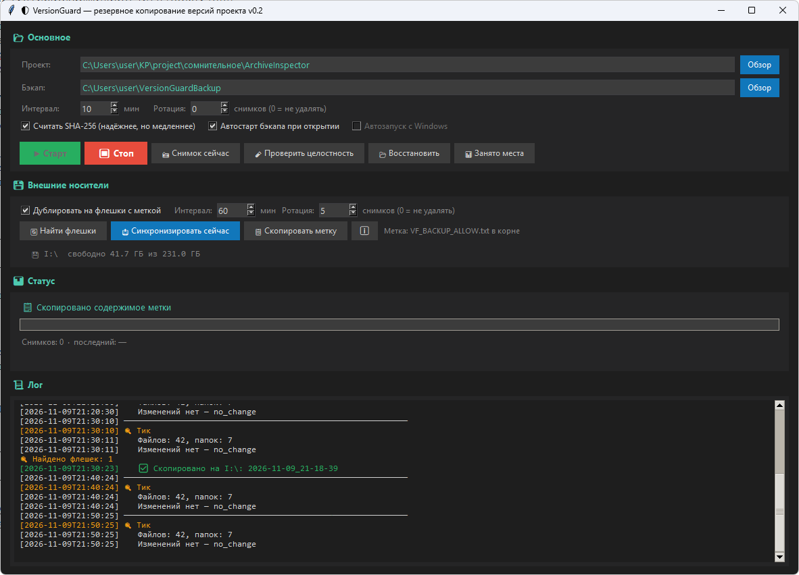

# VersionGuard v0.2
### Резервное копирование версий проекта
#### (c) AKSoft, 2026, koscl@yandex.ru

---


## ДЛЯ КОГО

Пишете книгу? Код? Песню? Диплом? Смету на ремонт?<br>

VersionGuard — простой и надёжный способ защитить вашу работу
от случайностей.<br>

Вы указали папку проекта — программа каждые 10 минут проверяет,
что изменилось, и сохраняет копию. Изменился один файл — копия
только его, а не всего проекта. Занимает место экономно.<br>

Завис компьютер во время сохранения документа? Выключили свет?
Случайно перезаписали файл старой версией?<br>

У вас всегда есть резервные копии на несколько шагов назад.<br>

---

Бэкап лучше хранить на ДРУГОМ диске — так защита надёжнее.

Но даже если у вас один физический диск — не страшно. Программа
может дублировать копии на флешки. Вставьте одну, две, три —
программа найдёт все с меткой и скопирует на каждую. Час назад
бэкап был на одной флешке, час назад — на другой. Всегда есть
актуальная копия, даже если основная папка повреждена.

---

⚠ И помните: это инструмент для повседневной страховки, а не
замена полноценной архивной копии. Раз в месяц (или чаще, если
работа важная) делайте полную резервную копию в облако или на
внешний диск, который храните отдельно от компьютера.




## ЗАПУСК

- Windows:  VersionGuard.exe
- Linux:    ./VersionGuard
- macOS:    VersionGuard.app (двойной клик)

Ничего устанавливать не нужно. Программа портативная.


## ЧТО ДЕЛАЕТ


Следит за папкой проекта и раз в N минут (по умолчанию 10) создаёт
резервный снимок. Если файлы не менялись — снимок не создаётся,
только запись в логе «изменений нет».<br>

Изменённые файлы копируются реально. Неизменённые — через хардлинки
(на NTFS / ext4 / APFS). Это значит, что каждый снимок выглядит полным,
но место на диске занимает только изменённое. Проверить:
кнопка «📊 Занято места».<br>

Дополнительно дублирует последний снимок на флешки с меткой.<br>


## КАК ПОЛЬЗОВАТЬСЯ


1. Укажите папку проекта (например, где лежит ваша книга или код).
2. Укажите папку для бэкапов (лучше на другом диске).
3. [▶ Старт].

Программа работает в фоне, пока окно открыто. Каждые N минут
проверяет папку. В логе — что скопировано, что пропущено, что
не изменилось.

Кнопки в основной панели:

```
  ▶ Старт          — начать резервное копирование
  ⏹ Стоп           — остановить
  📸 Снимок сейчас — сделать снимок немедленно
  🧪 Проверить целостность — полная проверка (медленно)
  📂 Восстановить  — восстановить снимок в другую папку
  📊 Занято места  — сколько реально занимает бэкап
```  


## ВОССТАНОВЛЕНИЕ


Восстановление ВСЕГДА в ДРУГУЮ папку. В папку проекта — запрещено
(защита от случайной перезаписи актуальных файлов).

```
1. [📂 Восстановить].
2. Выберите снимок (дата, время, размер).
3. Выберите, куда восстановить (по умолчанию
   C:\Users\<user>\VersionGuardRestore\<дата_снимка>).
4. [📂 Восстановить].
```

Файлы появятся в выбранной папке. Дальше — сравните с текущими и
скопируйте нужное вручную. Это осознанный шаг: программа не пишет
в проект, чтобы ничего не затереть.<br>

Опция «Не перезаписывать существующие файлы» включена по умолчанию.
Если восстанавливаете повторно в ту же папку — старые файлы не
затираются.<br>


## ФЛЕШКИ (ДОПОЛНИТЕЛЬНАЯ ЗАЩИТА)


Чтобы программа дублировала бэкап на флешку, в её корне нужен
файл-метка:

  `VF_BACKUP_ALLOW.txt`

Внутри должна быть строка:

  `VersionGuard backup marker`

Можно создать вручную, или нажать «📋 Скопировать метку» в панели
«Внешние носители» — откроется окно с готовыми для копирования
именем файла и содержимым.<br>

Если вставлено несколько флешек с меткой — копирование идёт на все.
Интервал по умолчанию — 60 минут (настраивается).
На флешке хранится последний снимок (ротация — 5 по умолчанию).<br>

ВАЖНО: метка — это ваше согласие. Без неё программа не пишет на
флешку, даже если она вставлена. Так вы защищены от случайной
записи на чужой носитель.<br>


## НАСТРОЙКИ


Хранятся в домашней папке:

```
  Windows:  %USERPROFILE%\.versionguard_settings.json
  Linux/macOS:  ~/.versionguard_settings.json
```

Структура бэкапа:

```
  <ваша папка>/
    manifest.json         — список снимков и настройки
    backup.log            — лог (ротация при 10 МБ)
    snapshots/
      2026-11-09_21-00-22/  — снимок
        files.json            — список файлов и хэши
        <файлы проекта>
```

Не редактируйте снимки вручную. Они помечены read-only. Если нужно
поправить файл — скопируйте его из снимка, не меняйте сам снимок.


## ХАРДЛИНКИ И МЕСТО НА ДИСКЕ


Проводник Windows и Total Commander показывают «логический» размер —
сумму всех файлов во всех снимках. Это НЕ реально занятое место.<br>

Реально на диске хранятся только изменённые файлы. Неизменённые —
хардлинки (несколько имён для одного блока). Кнопка «📊 Занято
места» показывает оба числа и объясняет разницу.<br>

Пример: 50 снимков по 49 МБ логически = 2.4 ГБ, но реально на
диске — 50 МБ (потому что менялся 1 файл).<br>

Хардлинки поддерживаются на NTFS (Windows), ext4/XFS/Btrfs (Linux),
APFS (macOS). На FAT32/exFAT (флешки) — не поддерживаются, программа
копирует файлы полностью. При синхронизации на флешку хардлинки
«раскрываются» в реальные копии — это нормально.<br>


## БЕЗОПАСНОСТЬ


Программа бесплатна. Распространяется «как есть» (as is), без
гарантий. Автор не несёт ответственности за любой ущерб, включая
потерю данных.<br>

⚠ ВСЕГДА ДЕЛАЙТЕ РЕЗЕРВНУЮ КОПИЮ ВАЖНЫХ ФАЙЛОВ.<br>

Работает локально, без интернета. Не читает содержимое файлов
(только SHA-256 для проверки). Ничего не отправляет наружу.<br>

Антивирус может ругаться на бинарник (ложное срабатывание
PyInstaller). Добавьте в исключения, если доверяете источнику.<br>


## СВЯЗЬ


GitHub:   https://github.com/artemsoft2025/
Telegram: https://t.me/avhelpnew
Email:    koscl@yandex.ru


